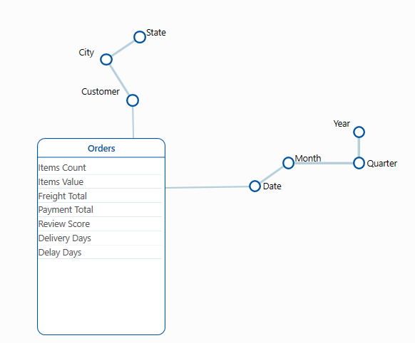
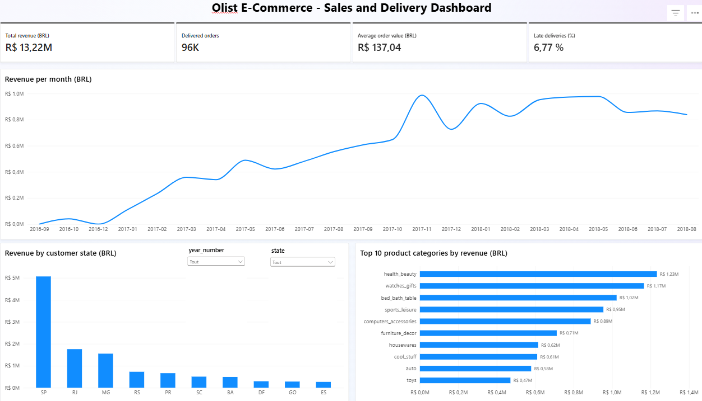

# Olist E-Commerce Data Warehouse (Indyco + PostgreSQL + Power BI)

End-to-end data warehouse project: conceptual design in Indyco Builder, a star schema in
PostgreSQL, a SQL ETL, and a Power BI dashboard.

## Business questions
1. How does revenue evolve month by month?
2. Which product categories and customer states generate the most revenue?
3. How fast are deliveries, and where are they late?
4. Do late deliveries lead to worse reviews?
5. Who are the top sellers?

## Architecture
CSV files (Kaggle) -> PostgreSQL staging (schema `stg`) -> Star schema (schema `dw`) -> Power BI

## Data model
- Fact `fact_sales` (grain: one order item): price, freight_value
- Fact `fact_orders` (grain: one order): items_count, items_value, freight_total,
  payment_total, review_score, delivery_days, delay_days, is_late
- Dimensions: `dim_date`, `dim_customer`, `dim_product`, `dim_seller` (shared by both facts)

## How to reproduce
1. Download the data (see `data/README_data.md`).
2. Install PostgreSQL and create a database called `olist_dw`.
3. Run `sql/01` and `sql/02`, import the CSV files into the `stg` tables,
   then run `sql/03` to `sql/06` in order (pgAdmin Query Tool).
4. Open `powerbi/olist_dashboard.pbix` and point it to your own database.

## Key findings
- **Scale:** the warehouse covers about 96,000 delivered orders and 13.2 M BRL of item
  revenue (freight excluded), an average order value of about 137 BRL.
- **Delivery reliability:** 6.77% of delivered orders arrived after the promised date.
  Late deliveries are highest in AL (21.4%) and lowest in
  AM (2.8%).
- **Customer satisfaction:** late orders get an average review score of 2.27, against 4.29
  for on-time orders, so delivery delays clearly hurt customer ratings.
- **Revenue concentration:** health_beauty is the top category with 123,3132 BRL
  (9.3% of revenue), and SP alone generates 38.3% of revenue.

## Dashboard

## Tools
Indyco Builder, PostgreSQL, pgAdmin, SQL, Power BI, Git/GitHub.

## Report
See `report/report.pdf`.

## Data source and license
## Data source and license
Data: "Brazilian E-Commerce Public Dataset by Olist", Kaggle
(https://www.kaggle.com/datasets/olistbr/brazilian-ecommerce),
licensed under CC BY-NC-SA 4.0
(https://creativecommons.org/licenses/by-nc-sa/4.0/).

Changes made: only delivered orders with a delivery date were kept;
city names were reformatted; product categories were translated to English;
data was restructured into a star schema (fact and dimension tables).

This project is not endorsed by or affiliated with Olist.
It is a non-commercial educational project. The raw data is not included
in this repository. Derived material (report, result tables, dashboard)
is shared under CC BY-NC-SA 4.0.

## Author
Nazim Sakhri (https://www.linkedin.com/in/nazim-sakhri/)- Master in Data Science and Business Analytics, Bologna Business School.
